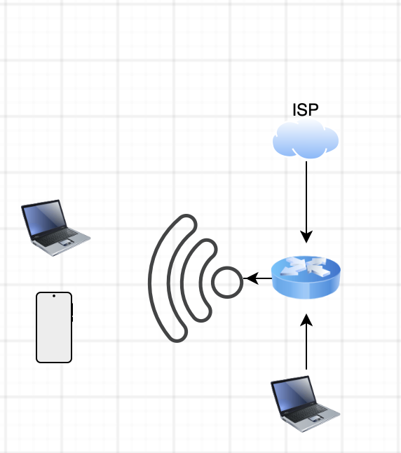
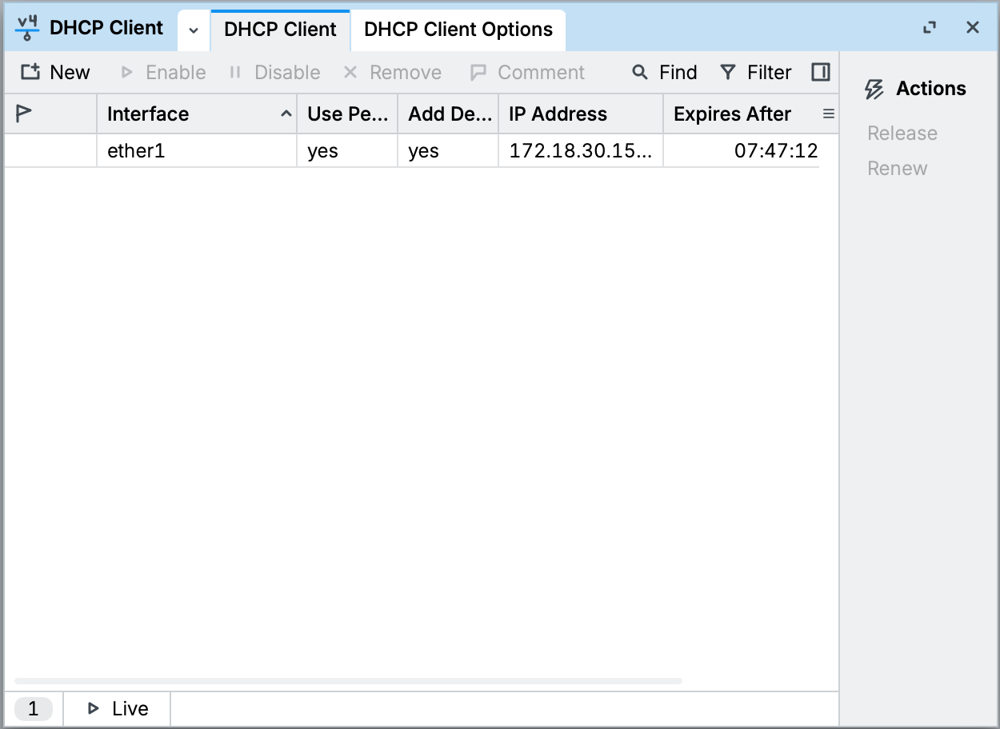
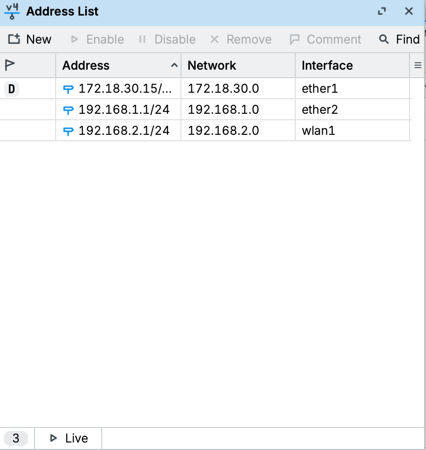
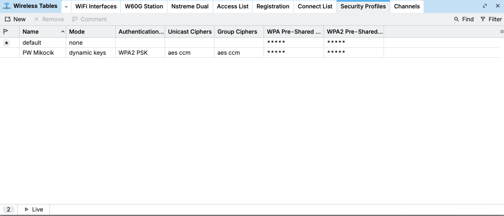
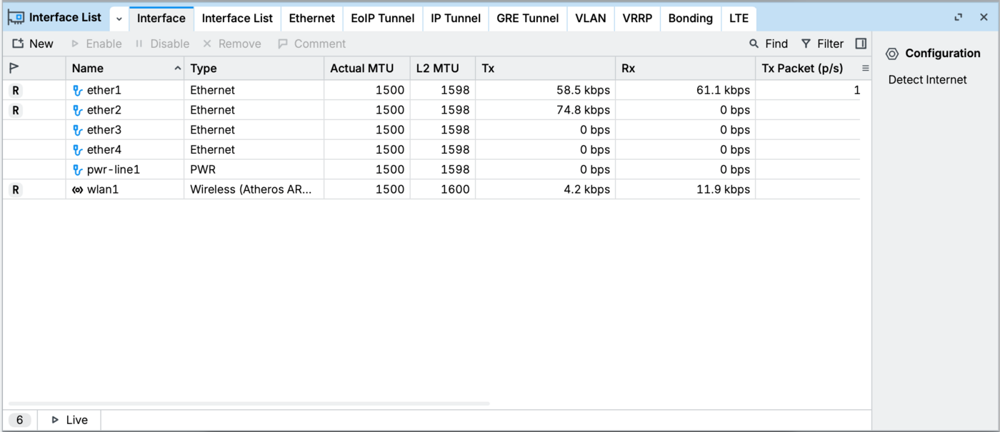
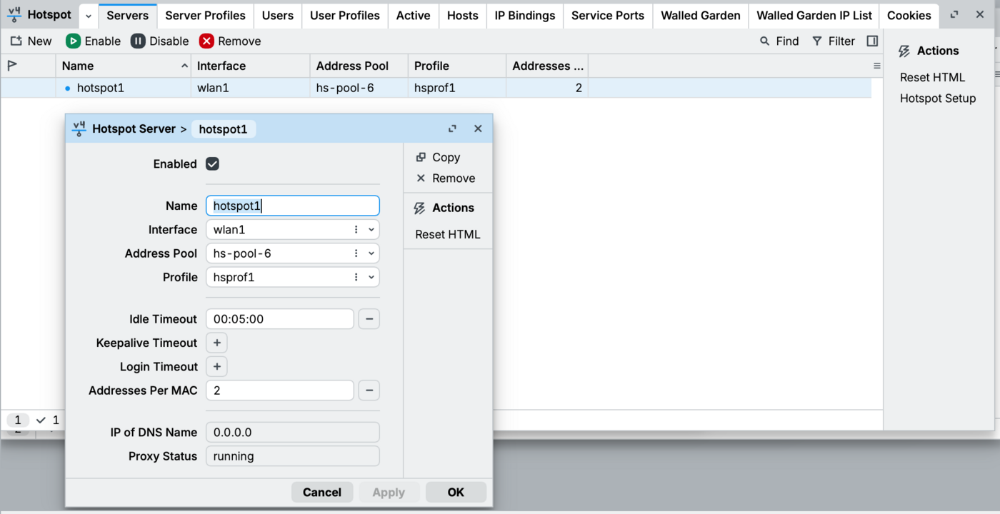
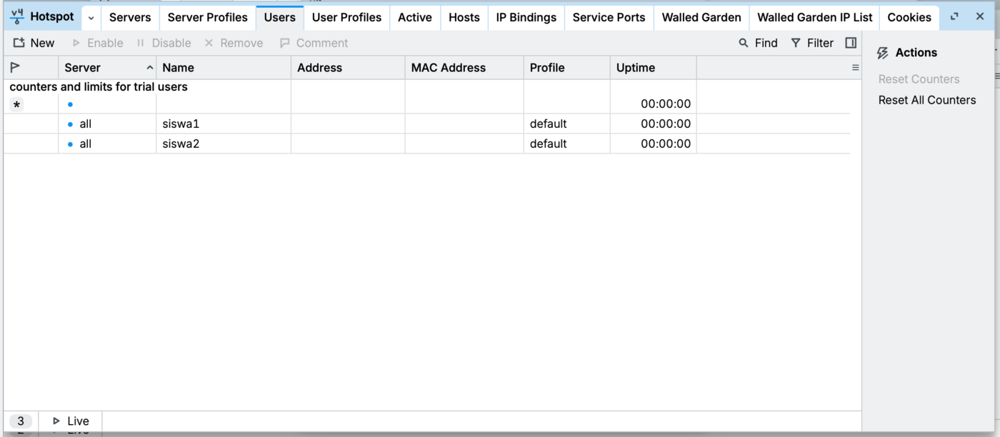
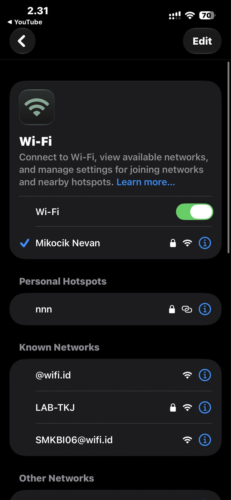
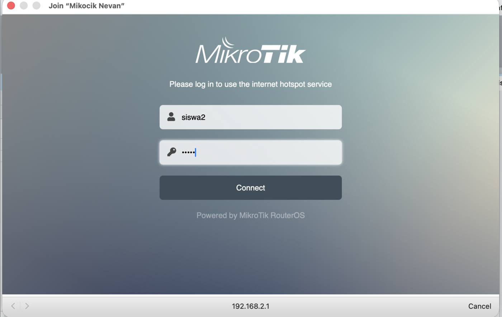

# Laporan Kasus Jaringan — Instalasi Jaringan Small Office

Studi kasus perancangan dan instalasi jaringan gabungan **kabel + nirkabel** untuk kantor kecil, menggunakan satu router MikroTik sebagai gateway sekaligus access point.

- **Oleh:** Nevan Kaindra Rusdi — SMK Bina Informatika (TKJ)
- **Tanggal:** 10 Agustus 2026
- **Tools:** MikroTik RouterOS, Winbox

## Latar Belakang

Sebuah kantor kecil membutuhkan jaringan yang dapat menghubungkan perangkat melalui media kabel maupun nirkabel secara bersamaan. Kebutuhannya muncul karena ada kombinasi perangkat: komputer/laptop yang terhubung langsung lewat kabel UTP untuk stabilitas dan kecepatan tinggi, serta laptop dan smartphone yang butuh akses internet secara mobile lewat Wi-Fi.

Jaringan terhubung ke internet melalui ISP, lalu didistribusikan oleh satu router yang berfungsi ganda sebagai **gateway kabel** dan **access point nirkabel**.

## Tujuan

- Merancang topologi jaringan gabungan kabel dan nirkabel yang efisien.
- Melakukan instalasi perangkat keras jaringan (router, kabel UTP, access point) sesuai standar.
- Melakukan konfigurasi dasar router: IP address, DHCP server, SSID, dan keamanan Wi-Fi.
- Menguji konektivitas jaringan kabel dan nirkabel agar semua perangkat saling terhubung dan bisa akses internet.

## Perancangan / Topologi

Topologi yang digunakan adalah **topologi star** dengan router sebagai pusat (central node), dikombinasikan dengan jaringan nirkabel yang dipancarkan langsung oleh router yang sama.

| Interface | Fungsi | IP Address |
|---|---|---|
| ether1 | WAN (ke ISP, DHCP Client) | dari ISP (172.18.30.x) |
| ether2 | LAN kabel | 192.168.1.1/24 |
| wlan1 | Hotspot / Wi-Fi | 192.168.2.1/24 |

## Konfigurasi

1. Login ke router lewat **Winbox** memakai MAC address.
2. **IP > DHCP Client**, tambahkan interface `ether1` supaya dapat IP dari ISP.
3. **IP > Addresses**, tambahkan IP `192.168.1.1/24` di `ether2` dan `192.168.2.1/24` di `wlan1`.
4. **Wireless > wlan1**, atur mode `ap bridge`, isi SSID, aktifkan interface.
5. Buat **security profile WPA2 PSK** di Wireless > Security Profiles, lalu pasang di `wlan1`.
6. **IP > Firewall > NAT**, tambahkan rule `masquerade` dengan out-interface `ether1` supaya client bisa akses internet.
7. **IP > Hotspot > Hotspot Setup**, pilih interface `wlan1`, ikuti wizard sampai selesai (otomatis membuat DHCP server, IP pool, dan hotspot server).
8. Tambah user hotspot di **IP > Hotspot > Users** (misal `siswa1` dan `siswa2`).
9. Untuk `ether2`, buat DHCP server sendiri lewat **IP > DHCP Server > DHCP Setup** supaya laptop wired dapat IP otomatis.

## Dokumentasi & Pengujian

**DHCP Client di ether1 sudah dapat IP dari ISP** (172.18.30.15).

**Address List:** ether1 (WAN), ether2 (LAN 192.168.1.1/24), wlan1 (Hotspot 192.168.2.1/24).

**Security profile wireless "PW Mikocik"** memakai WPA2 PSK.

**Interface ether1, ether2, dan wlan1 aktif** (status `R`) dan ada trafik data.

**Hotspot server "hotspot1"** berjalan di interface wlan1.

**User hotspot terdaftar:** siswa1 dan siswa2.

**Smartphone berhasil connect** ke SSID "Mikocik Nevan".

**Halaman login hotspot muncul otomatis**, login memakai user siswa2.

## Kesimpulan

Router MikroTik berhasil dikonfigurasi sebagai gateway sekaligus access point. Jaringan kabel (ether2) dan nirkabel (wlan1/hotspot) berjalan bersamaan, masing-masing dengan DHCP sendiri, dan seluruh perangkat dapat mengakses internet lewat NAT masquerade. Autentikasi Wi-Fi diamankan dengan WPA2 PSK dan akses hotspot dikontrol lewat user login.

---

*Dokumentasi ini dibuat untuk pembelajaran. Dikerjakan di lingkungan lab.*
